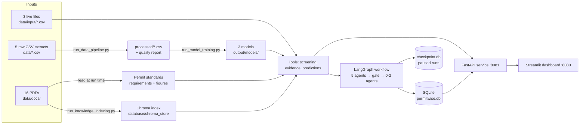
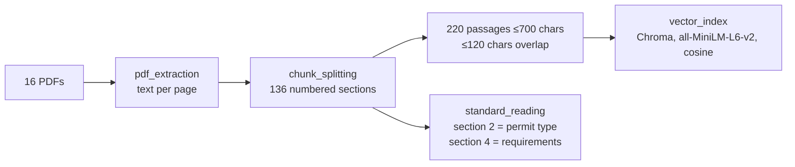
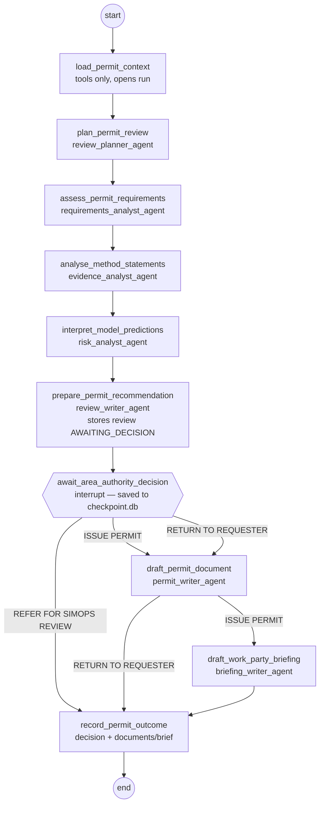
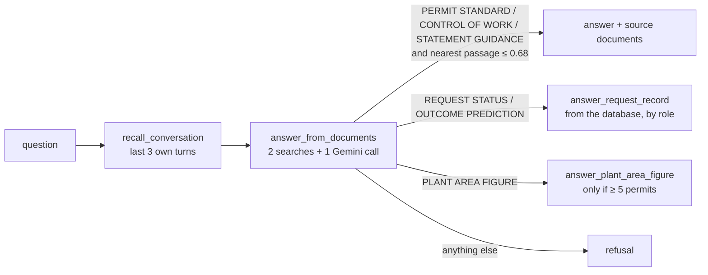

# PermitWise AI: architecture and flow

This document explains how PermitWise AI is built, what each part does, and how data moves from
the raw files to the dashboard. For how to use the dashboard see
[README_DASHBOARD_GUIDE.md](README_DASHBOARD_GUIDE.md). For who builds what, see
[README_TEAM_PLAN.md](README_TEAM_PLAN.md).

---

## 1. The problem in one paragraph

Hexley Chemicals runs Thornmere Works, a chemical site of 29 plant areas in 4 area groups. Every
hazardous job needs a **permit to work** of one of five types: Hot work, Confined space entry,
Electrical isolation, Work at height and Excavation. Contractors send requests through three
channels (Site portal, Contractor app, Scanned paper), each writing values differently: `PTW-52118`
or `52118`, `4.3 mg/m3` or `3 ppm`, `30 ft` or `9.1 m`, and so on. PermitWise AI cleans
those requests and checks each one against **its own permit standard (a PDF)**. It counts the
permits already live beside it, decides whether a SIMOPS (simultaneous operations) review is
needed, reads every sentence of the attached documents, and predicts the suspension likelihood and
the work hours. It prepares a review with a recommendation, then **stops**: only an Area Authority
appointed for that plant area, and who did not open the review, can decide.

## 2. Three rules that shape the whole design

1. **No requirement figure lives in the code.** Every limit (for example "flammable gas at most 5 %
   LEL") is read at run time from the standard's own PDF. Changing the PDF changes the rule.
2. **Models and LLMs never decide.** Screening results, counts and triggers come from ordinary
   code. The ML figures are advice. Each language-model agent only *words* facts it is given.
3. **Every figure on the dashboard comes from the REST service.** The dashboard holds no business
   rule and reads no file.

## 3. The big picture



## 4. The six entry points (run in this order, from `Project/`)

| # | Command | Produces | What it does |
|---|---|---|---|
| 1 | `python3 run_database_setup.py` | `database/permitwise.db` | Creates the 6 tables and the 16 seed accounts (salted, hashed passwords). Safe to run again. It refuses a database from an older version. |
| 2 | `python3 run_data_pipeline.py` | `processed/*.csv`, `output/data_quality_report.json` | Cleans the 5 extracts and records why each removed row was removed. |
| 3 | `python3 run_model_training.py` | `output/models/*.pkl`, `*_features.json`, `output/model_metrics.json` | Trains the 3 models; saves nothing unless all 3 reach their minimum score. |
| 4 | `python3 run_knowledge_indexing.py` | `database/chroma_store/` | Splits 16 PDFs into 136 sections and 220 passages, embeds them, and reads every standard's section 6 back as a check. |
| 5 | `python3 run_api_service.py` | `database/checkpoint.db` (on first review) | Checks every required file exists, then serves the API on port 8081. |
| 6 | `python3 -m streamlit run run_dashboard.py` | — | The dashboard on port 8080. |

Expected pipeline output (exact counts):

```
permit_history_train   29796 received ->  27797 kept  (1999 removed)
permit_history_eval     7455 received ->   6935 kept  (520 removed)
job_logs_train         28339 received ->  27705 kept  (634 removed)
job_logs_eval           7078 received ->   6930 kept  (148 removed)
statement_sentences    36666 received ->  35709 kept  (957 removed)
```

## 5. Stage by stage

### 5.1 Data pipeline (`data_pipeline/`)

| Module | Responsibility |
|---|---|
| `dataset_loader.py` | The only module that reads or writes CSVs. Raw files are read as text. Only the null tokens (`N/A`, `-`, `illegible`, …) become blank. |
| `common_cleaning.py` | Shared repairs: exact duplicates, canonical permit references (`PTW` + 7 digits), canonical spellings (`HW` → `Hot work`), whole numbers, **unit conversion with exact decimals and one half-up rounding**, impossible readings blanked, latest revision kept, markup stripped from text. |
| `request_cleaning.py` | Requests (history and live queue) and the live permit register. |
| `history_cleaning.py`, `job_log_cleaning.py`, `sentence_cleaning.py`, `document_cleaning.py` | One cleaner per dataset type. |
| `quality_profiler.py` | Counts how dirty each extract was. Every removed row is explained by one of: duplicate, missing target, earlier revision, impossible target, too few words. |
| `feature_builder.py` | Requirement counts and SIMOPS flags for each past request (worked out by the same screening a live request gets), plus the model input layout and the sklearn preprocessing pipeline. |

How a reading is converted: `4.3 mg/m3` of hydrogen sulphide ÷ 1.42 = 3.028… → rounded **once**,
half up, to 3.0 ppm. An unknown notation (such as `3% LEL` with the wrong spacing) is **refused
with an error naming the column and the value**; it is never guessed.

### 5.2 Knowledge base (`knowledge/`)



- **`standard_reading.read_permit_standard`** finds each permit type's own PDF and checks that
  section 2 names that permit type. It then splits section 4 into numbered requirements and
  matches each to one sentence pattern in config, keeping its figures as exact `Decimal`s. Real
  values today: Hot work flammable gas ≤ 5 % LEL; Confined space entry ≤ 10 % LEL; Electrical
  isolation circuit earths above 1000 V; Work at height wind ≤ 12 m/s; Excavation trench support
  deeper than 1.2 m.
- **`vector_index`** stores each passage with its document, section and passage number, plus the
  number of characters it repeats from the passage before. That lets
  `read_document_section` rebuild any section exactly.
- The casebook PDF is indexed but **never returned to the chat**.

### 5.3 Models (`modeling/`)

| Model | Algorithm | Input | Held-out score (minimum) |
|---|---|---|---|
| Suspension likelihood | Logistic regression (calibrated, monotone) | 20 numbers incl. requirement counts, live/conflicting permits, 3 SIMOPS flags + 7 categories | ROC AUC **0.83** (0.79) |
| Expected work hours | HistGradientBoosting on log(hours) | 12 numbers incl. flags + 8 categories | R² **0.89** (0.84) |
| Sentence type (9 types) | TF-IDF (1–2 grams) + LinearSVC | sentence text | macro F1 **0.98** (0.95) |

Every model is one sklearn `Pipeline` (`preprocessing` → `estimator`). The pipeline fills blanks
with the training median or most frequent value, so a request with gaps can still be scored.
Likelihood is banded LOW < 0.20 ≤ MEDIUM < 0.40 ≤ HIGH. An extension is expected when the expected
hours are more than 1.3 × the planned hours.

### 5.4 Tools (`tools/`), the facts layer

Everything an agent is told is worked out here, by ordinary code:

| Module | Gives |
|---|---|
| `request_data_tools` | Live queue, documents, register, history; `fetch_request`; queue order (confined space entry first); `describe_record` wording |
| `screening_tools` | `count_live_permits`, `find_simops_triggers`, `screen_request` (Met / Not met / Not documented, blank answers, assessment, decisions open) |
| `evidence_tools` | Sentence-by-sentence reading of documents; which requirements each sentence bears on; gas readings that disagree with the form |
| `prediction_tools` | Likelihood + band, expected hours + extension, wording |
| `retrieval_tools` | Exact sections: reviewer checks, documentation to provide, permit document, briefing, policy |
| `permit_document_tools` | Details of the permit document, rework request and SIMOPS brief |
| `decision_tools` | Why a decision may be refused, checked **before** any LLM call is spent |

**Assessment logic:** any requirement Not met or Not documented → `RETURN TO REQUESTER`; else any
SIMOPS trigger → `REFER FOR SIMOPS REVIEW`; else `ISSUE PERMIT`. The three SIMOPS triggers:

- a conflicting live permit in the same area (Hot work with Confined space entry or Excavation);
- Hot work or Confined space entry on a unit that is not shut down;
- Electrical isolation above 1000 V.

A blank answer never lets a request slip through: a blank unit status counts as live, and a blank
voltage counts as high.

### 5.5 The agent workflow (`agentic/`)



- **LLM calls:** 5 before the gate; 7 in total for an issue, 6 for a return, 5 for a referral.
- Each agent sends one Gemini prompt (model and key come from `.env`) and asks for labelled fields
  (`PRIORITY:`, `CHECKS:` …). `parse_labelled_response` reads them back, tolerating `**bold**`,
  `## headings` and repeated labels.
- If a reply fails its checks (for example, a document without the sign-off "Permit Office, Hexley
  Chemicals", or a forbidden word such as "likelihood"), the agent asks again (up to 3 times).
  Only the accepted call is recorded, so call counts stay exact.
- **The gate:** LangGraph `interrupt()` pauses the run, and `SqliteSaver` writes it to
  `database/checkpoint.db`. The run can be resumed by another process, even after a restart.
- **Who may decide:** an Area Authority, appointed for the request's area group, who **did not
  open** the review, choosing only from the decisions open.

### 5.6 Persistence (`persistence/`)

| Table | Holds |
|---|---|
| `user_accounts` | username, display name, role, area group, password hash + salt, current session token |
| `agent_runs` | one row per workflow run: thread, opener, status (RUNNING / AWAITING_DECISION / COMPLETE / FAILED), call count |
| `permit_reviews` | the stored review: screening, permits, evidence, flags, figures, five write-ups, recommendation, outcome documents |
| `review_decisions` | one decision per review, with who, role, area group and reason |
| `llm_calls` | every accepted LLM call: agent, model, prompt/response/total tokens, latency in ms |
| `chat_turns` | every chat question and answer, refusals included |

All queries live in `repository.py`; nothing else runs SQL.

### 5.7 Access control (`access/`)

- Passwords: PBKDF2-SHA256, 200,000 rounds, 16-byte salt per account.
- Sign-in returns a random token, sent as the `X-Session-Token` header. Signing in again ends the
  old session.
- `authorize_request` guards every route except sign-in and sign-out. It maps
  (method, path template) to a permission and refuses with **401** (not signed in) or **403** (role
  lacks the permission).
- `authorize_plant_area` restricts an Area Authority to the plant areas of their own group.

| Role | Permissions | Pages |
|---|---|---|
| Area Authority | queue, review, decision, audit, chat | all 5 |
| Permit Coordinator | queue, review, audit, chat | queue, detail, audit, chat |
| Control Room Operator | chat | chat only |

### 5.8 REST service (`api/`)

| Method & path | Permission | Purpose |
|---|---|---|
| `POST /auth/signin`, `POST /auth/signout` | none | sessions |
| `GET /queue?permit_type=` | queue | ranked queue rows |
| `GET /queue/{permit_reference}` | queue | full detail (screening, evidence, figures) |
| `POST /reviews` | review | runs the 5 agents → **201** with the stored review |
| `GET /reviews?status_value=` | audit | reviews by status |
| `POST /reviews/{id}/decision` | decision | checks, then resumes the paused run |
| `GET /reviews/{id}/calls` | audit | calls recorded vs. expected, tokens, latency |
| `POST /chat/ask`, `GET /chat/turns` | chat | the assistant; own conversation |
| `GET /audit/chat-turns` | audit | everyone's chat turns |

The queue and every request's detail are worked out **once at start-up** (no LLM involved). Every
`ValueError` or Gemini/HTTP failure becomes a **502** with the message, and a run that failed is
marked FAILED.

### 5.9 The permit chat (`chat/`)



- Questions about a request are answered from the **records**, never by the model.
- A Control Room Operator hears only the permit type, plant area and status (plus the equipment
  tag and work party size once issued), and **never a prediction**.
- A plant-area figure is given only when at least 5 permits make it up, so no single contractor's
  crew can be singled out.

### 5.10 Dashboard (`dashboard/`, `run_dashboard.py`)

`api_client.call_service` is the only path to the service. It handles the token, the spinner,
the 401 "session ended" flow, and how errors are shown. `display.py` holds badge colours and small
table helpers from config. Each page module draws one page; see the dashboard guide for the
walkthrough.

## 6. Folder map

```
Project/
├── config/config.py            every constant, pattern, message and rule input (supplied)
├── data/                       raw extracts, data/input live files, data/docs 16 PDFs
├── data_pipeline/              loading, cleaning, profiling, features
├── knowledge/                  PDFs → sections → passages → Chroma; standard reading
├── modeling/                   3 models, evaluation, registry
├── tools/                      facts layer used by workflow, API and chat
├── agentic/                    agents (Gemini), state, nodes, graph
├── persistence/                engine, 6 tables, repository
├── access/                     password hashing, guards
├── chat/                       memory, assistant, record answers
├── api/                        schemas, routes
├── dashboard/                  api client, display helpers, 6 page modules
├── run_*.py                    6 entry points
├── processed/ output/ database/  generated artefacts
└── tests.py                    the 50-check marking suite
```

## 7. Testing

`python3 -m pytest tests.py -v` runs 50 checks: cleaning, models, knowledge base, screening, the
live review run (7 real Gemini calls), access, queue, chat and records. The current state is
**50 passed**. Each run reviews and issues one request that is still unreviewed and assessed
ISSUE PERMIT. When none are left, reset the database (see the dashboard guide).
