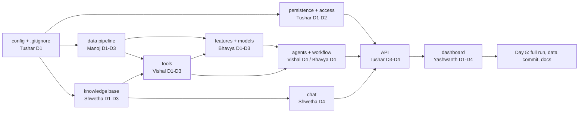

# PermitWise AI: team roles and 5-day upload plan

The working code is complete and tested (**50/50 tests pass**). This plan splits the project
across the six of us, so that each person owns, understands, uploads and can explain their own
part. By the end of Day 5, every file, including the generated data, models, index and database,
is merged into `main`.

Read [README_ARCHITECTURE.md](README_ARCHITECTURE.md) first. It explains every module named below.

---

## 1. Team and ownership

| Person | Role | Owns (folders / files) | Tests that prove their part |
|---|---|---|---|
| **Tushar** | **Team lead and integration**: platform, security, API | `config/`, `requirements.txt`, `.gitignore`, `README*.md`, `persistence/`, `access/`, `api/`, `run_database_setup.py`, `run_api_service.py`, final `database/` | `sign_in_and_out`, `roles_reach`, `queue_order`, `stored_review`, `model_calls`, `recommendation`, `issue_writes`, `run_waits`, and the **full suite** |
| **Manoj** | Data engineer | `data_pipeline/` (all except `feature_builder.py`), `run_data_pipeline.py`, `processed/`, `output/data_quality_report.json` | `cleaning_keeps`, `readings_made`, `references_types`, `answers_codes`, `impossible_readings`, `quality_report`, `statement_text_cleaning` |
| **Bhavya** | ML and workflow engineer | `data_pipeline/feature_builder.py`, `modeling/`, `run_model_training.py`, `output/models/`, `output/model_metrics.json`, `agentic/state.py`, `agentic/nodes.py`, `agentic/graph.py` | `schemas_leave`, `counts_and_triggers`, `inputs_follow`, `models_fit`, `suspension_model`, `work_hours_model`, `suspension_rises`, `expected_hours`, `sentence_model`, `sentence_predictions`, `workflow_nodes`, `agents_called`, `run_resumes` |
| **Shwetha** | Knowledge base and chat engineer | `knowledge/`, `tools/retrieval_tools.py`, `run_knowledge_indexing.py`, `database/chroma_store/`, `chat/` | `every_document`, `documents_cut`, `index_holds`, `tools_read`, `chat_search`, `own_standard`, `keep_sentence`, `twin_gas`, `laid_out`, `reading_repeatable`, `chat_answers`, `plant_area_figures` |
| **Vishal** | Rules and agents engineer | `tools/` (request_data, screening, evidence, prediction, permit_document, decision), `agentic/agents.py` | `bands_and`, `statements_split`, `sentences_link`, `boundary`, `follow_on`, `linked_request`, `simops_triggers`, `assessment_decisions`, `decorated_reply`, `decision_once` |
| **Yashwanth** | Dashboard (UI) engineer | `dashboard/` (all 8 files), `run_dashboard.py`, `.streamlit/config.toml`, `README_DASHBOARD_GUIDE.md` | No marking test covers the UI: the manual checklist in section 6, plus the AppTest smoke check |

Run your own tests with, for example:
`python3 -m pytest tests.py -v -k "cleaning_keeps or readings_made"`

### Responsibilities in detail

**Tushar (Team lead)**
- Owns `main`: reviews and merges every pull request (PR) the same day it is raised, and keeps
  merge order on dependencies (section 3).
- Keeps the repository clean: `.gitignore`, no secrets, no `__pycache__`, and restores the CI
  files.
- Builds the security and API layer: password hashing, session tokens, permission guard, area
  group rule, the six tables, and every REST endpoint.
- Runs the full suite on Day 4 and Day 5, assigns any failure to its owner, and does the final
  data commit.
- Holds the daily 15-minute stand-up (done, today, blocked).

**Manoj (Data)**: turns the 5 messy extracts into clean tables with exact unit conversion and
refusals for unreadable values, and produces the quality report. Must be able to explain why each
removed row was removed (counts must match: 27797 / 6935 / 27705 / 6930 / 35709 rows kept).

**Bhavya (ML and workflow)**: builds the features (requirement counts, SIMOPS flags), trains and
evaluates the 3 models (AUC ≥ 0.79, R² ≥ 0.84, macro F1 ≥ 0.95), and wires the LangGraph workflow:
10 nodes, 2 branches, the pause at the gate, and the SQLite checkpoint.

**Shwetha (Knowledge and chat)**: turns the 16 PDFs into 136 sections and 220 passages in Chroma,
reads each permit standard's requirements from its own PDF (no figures written in code), and
builds the chat: memory, the grounded answer, answers from the records, and the group-size rule.

**Vishal (Rules and agents)**: the screening rules (Met / Not met / Not documented, the follow-on
questions, linked standards), SIMOPS triggers, evidence and disagreement flags, prediction
wording, documents and decision refusals, and the 7 Gemini agent prompts with the reply parser.

**Yashwanth (Dashboard)**: the sign-in page and the 5 role-gated pages, all fed only through
`api_client.call_service`. He also owns the visual polish, the screenshots and the usage guide.

---

## 2. Git rules (everyone, every day)

1. **Work on your own branch.** These already exist on GitHub:
   `PERMITWISE-AI-tushxx` (Tushar), `PERMITWISE-AI-devarlamanojkumarreddy-netizen` (Manoj),
   `PERMITWISE-AI-bhavya1006` (Bhavya), `PERMITWISE-AI-shwetha02903` (Shwetha),
   `PERMITWISE-AI-Vishal88-S` (Vishal). **Yashwanth** creates `PERMITWISE-AI-yashwanth` on Day 1.
2. Start every day with `git checkout main && git pull`, then
   `git checkout <your-branch> && git merge main`.
3. Commit only your own files, by name. **Never `git add -A` or `git add .`.**
   Use, for example: `git add Project/data_pipeline/common_cleaning.py`
4. **Never commit `Project/.env` with the real key.** The committed copy holds placeholders only.
   After pulling, protect your local copy:
   `git update-index --skip-worktree Project/.env`
5. One PR per person per day, titled `Day N – <name> – <what>`. Tushar merges it by the end of
   the day.
6. Commit messages: `feat(data): add reading conversion with half-up rounding` (use `feat`,
   `fix`, `docs`, `test` or `chore`).
7. Before raising a PR, run your own tests (section 1). Paste the result line into the PR
   description.

---

## 3. Dependency order (why the days are arranged this way)

---

## 4. Day-by-day plan

All paths are under `Project/`. "Upload" means: commit on your branch, push, and raise the PR.

### Day 1: foundations

| Person | Upload | Done when |
|---|---|---|
| Tushar | `.gitignore` (ignore `__pycache__/`, `.pytest_cache/`, `*.pyc`); restore the CI files deleted locally (from the repo root: `git checkout -- .github/workflows/build.yml sonar-project.properties`); `config/config.py`; `requirements.txt`; `README.md`; `persistence/database.py`; `persistence/models.py` | Every branch can `pip install -r requirements.txt`; tables import |
| Manoj | `data_pipeline/dataset_loader.py`, `data_pipeline/common_cleaning.py` | A raw file loads; `30 ft` → 9.1 and `7.1 mg/m3` H₂S → 5.0 in a quick check |
| Bhavya | `modeling/model_registry.py`, `modeling/model_evaluation.py` | Save, load and round-trip a dummy pipeline |
| Shwetha | `knowledge/pdf_extraction.py`, `knowledge/chunk_splitting.py` | 16 documents → 136 sections; passages ≤ 700 characters |
| Vishal | `tools/request_data_tools.py`, `tools/screening_tools.py` | Screens a hand-made request (boundary cases, follow-on questions) |
| Yashwanth | `.streamlit/config.toml`, `dashboard/api_client.py`, `dashboard/display.py`, `dashboard/sign_in.py`; create his branch | Sign-in page renders against the running API |

### Day 2: core logic

| Person | Upload | Done when |
|---|---|---|
| Tushar | `persistence/repository.py`, `access/password_security.py`, `access/permissions.py`, `run_database_setup.py`; run it and check it reports *16 created*, then *0 created, 16 present* | `sign_in_and_out` passes once Day 3 API lands |
| Manoj | `data_pipeline/request_cleaning.py`, `document_cleaning.py`, `history_cleaning.py`, `job_log_cleaning.py`, `sentence_cleaning.py` | His cleaning tests pass, except `quality_report` |
| Bhavya | `data_pipeline/feature_builder.py`, `modeling/suspension_model.py`, `modeling/work_hours_model.py`, `modeling/sentence_model.py` | Models train in a notebook and reach their minimums |
| Shwetha | `knowledge/vector_index.py`, `knowledge/standard_reading.py` | Her knowledge tests pass, except `tools_read` |
| Vishal | `tools/evidence_tools.py`, `tools/prediction_tools.py` | `statements_split`, `sentences_link` pass (needs Bhavya's saved model by Day 3) |
| Yashwanth | `dashboard/request_queue.py`, `dashboard/request_detail.py` | Queue and detail pages show live data |

### Day 3: run the stages and commit their outputs

| Person | Upload | Done when |
|---|---|---|
| Tushar | `api/schemas.py`; first part of `api/routes.py` (sign-in/out, queue, detail) | `sign_in_and_out`, `roles_reach`, `queue_order` pass |
| Manoj | `data_pipeline/quality_profiler.py`, `run_data_pipeline.py`; **run it**; commit `processed/*.csv` and `output/data_quality_report.json` | All 7 data tests pass; row counts match |
| Bhavya | `run_model_training.py`; **run it**; commit `output/models/*` and `output/model_metrics.json`; `agentic/state.py` | All model tests pass |
| Shwetha | `tools/retrieval_tools.py`, `run_knowledge_indexing.py`; **run it**; commit `database/chroma_store/` | All knowledge tests pass |
| Vishal | `tools/permit_document_tools.py`, `tools/decision_tools.py` | `boundary`, `follow_on`, `linked_request`, `simops_triggers`, `assessment_decisions`, `bands_and` pass |
| Yashwanth | `dashboard/decision_queue.py`, `dashboard/audit_trail.py` | Both pages render with no error box |

### Day 4: agents, chat and the full API

| Person | Upload | Done when |
|---|---|---|
| Tushar | Rest of `api/routes.py` (reviews, decision, calls, chat, audit, failure handler), `run_api_service.py`; first **full-suite run**; files issues for each failure | API starts; `run_api_service.py` names missing files when one is removed |
| Manoj | Fixes from the full run; helps Vishal test screening on real history rows; writes the data section of the architecture document | No data test fails |
| Bhavya | `agentic/nodes.py`, `agentic/graph.py` | `workflow_nodes` passes; a review pauses at the gate and resumes after an API restart |
| Shwetha | `chat/conversation_memory.py`, `chat/record_answer.py`, `chat/permit_assistant.py` | `chat_answers`, `plant_area_figures` pass |
| Vishal | `agentic/agents.py` (7 prompts, parser, Gemini client) | `decorated_reply`, `agents_called`, `model_calls`, `recommendation` pass |
| Yashwanth | `dashboard/permit_chat.py`, `run_dashboard.py` | All roles see the right pages; the chat works end to end |

### Day 5: integration, data commit, documentation

| Person | Upload | Done when |
|---|---|---|
| Tushar | Merge all branches into `main`. On a clean clone, run the 6 entry points in order, then the full suite (**50 passed**). Reset the database (`run_database_setup.py` on a fresh `database/`), run one demo review, and commit `database/permitwise.db` + `database/checkpoint.db` together. Final `README*.md`. Tag `v1.0`. | `main` has every source file, `processed/`, `output/`, `database/`; CI green |
| Manoj | Re-run the pipeline on `main` and confirm the files are unchanged (`git status` clean) | No diff |
| Bhavya | Re-run training on `main`; confirm the metrics still meet the minimums | `model_metrics.json` within ±0.01 |
| Shwetha | Re-run indexing on `main`; confirm 16 / 136 / 220 | Read-back output matches the standards |
| Vishal | Review all 7 agents' stored outputs from the demo run: sign-off, no forbidden words, no staff names | Checklist signed in the PR |
| Yashwanth | Dashboard checklist (section 6) with screenshots added to `docs/screenshots/`; final `README_DASHBOARD_GUIDE.md` | Every checklist item ticked |

---

## 5. What "all project data in git" means at the end

| Path | Committed by | Size (approx.) |
|---|---|---|
| `Project/data/` (raw extracts, live files, 16 PDFs) | already in git | 20 MB |
| `Project/processed/*.csv` | Manoj, Day 3 | 19 MB |
| `Project/output/data_quality_report.json`, `output/model_metrics.json`, `output/models/*` | Manoj / Bhavya, Day 3 | 0.7 MB |
| `Project/database/chroma_store/` | Shwetha, Day 3 | ~3 MB |
| `Project/database/permitwise.db` + `checkpoint.db` | Tushar, Day 5 (committed together) | < 1 MB |
| **Never committed** | `.env` with the real key, `__pycache__/`, `.pytest_cache/` | — |

Every file is under GitHub's 100 MB limit, so no Git LFS is needed.

---

## 6. Dashboard checklist (Yashwanth, Day 5)

- [ ] Sign in as each of `dara`, `marcus` and `liam`: the sidebar shows the name, role and group,
      and the pages shown match the role.
- [ ] Wrong password shows "Username or password is not correct".
- [ ] Signing in as the same user in a second browser makes the first one show "Your session
      ended…".
- [ ] Queue: counts are shown; the Hot work filter keeps only Hot work and Hot work-linked rows;
      selecting a row opens the detail page.
- [ ] Detail: all 4 tabs; flagged sentence box on PTW0052129; area-group note for `kofi` on
      PTW0052117.
- [ ] Start a review as `marcus`, decide it as the right Area Authority; the opener sees the
      "must be decided by the other…" note.
- [ ] Audit trail: the call budget shows "7 of 7" for an issue, "6 of 6" for a return, "5 of 5"
      for a referral.
- [ ] Chat: one question per type (see the usage guide); the operator never sees a prediction.
- [ ] Stop the API: the dashboard shows "not answering" with the start command.

---

## 7. Definition of done (whole team)

- `python3 -m pytest tests.py` → **50 passed** on `main` from a clean clone.
- The 6 entry points run in order with the expected console output.
- The dashboard checklist is complete.
- No secret is in the git history; the CI and Sonar files are restored.
- Every member can explain their own module from `README_ARCHITECTURE.md`.
